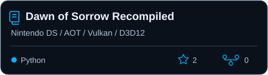
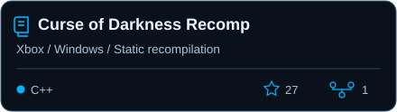
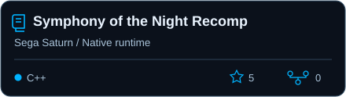
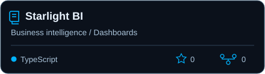
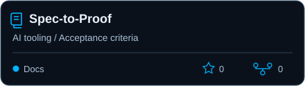
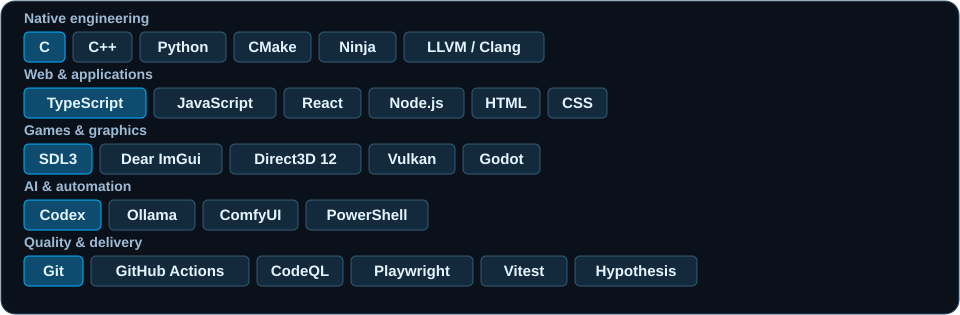
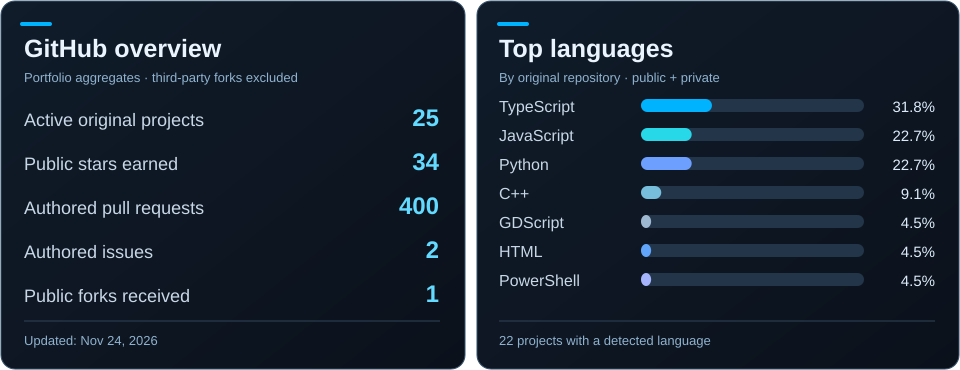

  

<strong>Game engineering · Artificial intelligence · Developer tooling</strong>

  <a href="#featured-projects">Projects</a> · <a href="#technology">Technology</a> · <a href="#engineering-principles">Engineering</a> · <a href="https://github.com/Neguchads?tab=repositories">Repositories</a> · <a href="#github-analytics">GitHub Analytics</a>

I develop tools, applications and experimental static game recompilation projects. My focus is on turning technical problems into reproducible solutions through clear documentation, automation and verifiable tests.

## Featured projects

<strong>Full project directory</strong>

### Game engineering and preservation

| Project | Description |
| :--- | :--- |
| **[Chad Standard Recomp](https://github.com/Neguchads/chad-recomp)** | Universal engineering standard for ports, recompilers and games. Draft specification, schema and manifest validator. |
| **[Dawn of Sorrow Recompiled](https://github.com/Neguchads/cdos-nintendods-recomp)** | Nintendo DS · AOT recompilation, Direct3D 12, Vulkan and RecompLauncher integration. [Releases](https://github.com/Neguchads/cdos-nintendods-recomp/releases) |
| **[Curse of Darkness Recomp](https://github.com/Neguchads/ccod-xbox-recomp)** | Xbox · Experimental Windows port through static recompilation. |
| **[Symphony of the Night Recomp](https://github.com/Neguchads/csotn-saturn-recomp)** | Sega Saturn · Native runtime, engine, recompilation tools and tests. |

### Applications and artificial intelligence

| Project | Description |
| :--- | :--- |
| **[Starlight BI](https://github.com/Neguchads/starlight-bi)** | Interactive dashboards and visual data editing. |
| **[ScriptForge](https://github.com/Neguchads/ScriptForge)** | Web studio for AI-assisted content and music creation. |
| **[Favorite Manager](https://github.com/Neguchads/favorite-manager)** | Chromium bookmark manager with local AI organization. |
| **[PoseClone / ComfyUI](https://github.com/Neguchads/comfyui)** | Python tools and workflows for visual references and character consistency. |

### Developer tooling

**[Spec-to-Proof](https://github.com/Neguchads/spec-to-proof)** — Requirements, acceptance criteria and evidence-based verification.  
**[Codex Universal Config](https://github.com/Neguchads/codex-config-universal)** — Portable configuration, privacy and reusable CI infrastructure.

## Technology

<picture>
  <source media="(prefers-color-scheme: light)" srcset="assets/stack.en.light.svg" />
  <source media="(prefers-color-scheme: dark)" srcset="assets/stack.en.svg" />
  
</picture>

Technology list (text)

| Area | Stack |
| :--- | :--- |
| Native engineering | C · C++ · Python · CMake · Ninja · LLVM/Clang |
| Web applications | TypeScript · JavaScript · React · Node.js |
| Games and graphics | SDL3 · Dear ImGui · Direct3D 12 · Vulkan |
| AI and automation | Codex · Ollama · ComfyUI · PowerShell |
| Quality and delivery | Git · GitHub Actions · CodeQL · Playwright · Vitest · Hypothesis |

## GitHub Analytics

<picture>
  <source media="(prefers-color-scheme: light)" srcset="assets/github-stats.en.light.svg" />
  <source media="(prefers-color-scheme: dark)" srcset="assets/github-stats.en.svg" />
  
</picture>

Cards show a snapshot from Nov 24, 2026; see the refresh documentation. Aggregated active original projects, including accessible public and private repositories; third-party forks, archived repositories and this profile repository are excluded from project and language totals. Authored PRs and issues in account-owned repositories reflect accessible GitHub search results. Stars and received forks are from public original projects only. No private repository names or links are published.

[Methodology & refresh](docs/PROFILE_ANALYTICS.md)

## Engineering principles

- **Reproducibility:** incremental builds, traceable dependencies and technical documentation.
- **Quality:** regression and property tests, fuzzing and benchmarks where applicable.
- **Security:** static analysis, integrity checks and distribution evidence where available.
- **Open source:** project-specific licensing, dependency attribution and respect for third-party rights.

Game ports are experimental and require your own compatible game copy. Consult each project's README and licensing terms before redistribution or reuse.

---

  <strong>Explore. Build. Verify.</strong> 
  <a href="https://github.com/Neguchads?tab=repositories">All public repositories</a>

