

  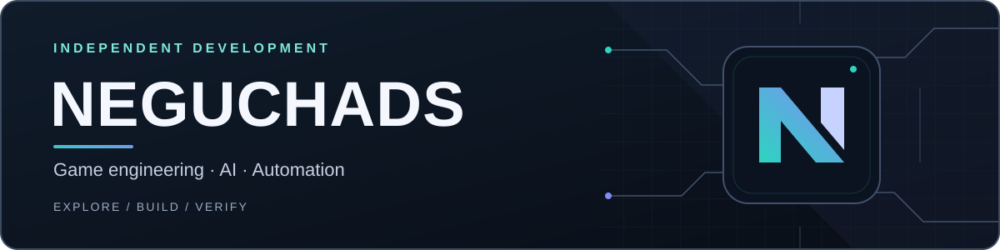

  <strong>Engenharia de jogos · Inteligência artificial · Ferramentas para desenvolvedores</strong>

  <a href="#navi-os--command-center">NAVI-OS</a> · <a href="#navi-engineering-universe">Universe</a> · <a href="#projetos-em-destaque">Projetos</a> · <a href="#tecnologias">Tecnologias</a> · <a href="#github-analytics">Analytics</a> · <a href="https://github.com/Neguchads?tab=repositories">Repositórios</a>

Desenvolvo ferramentas, aplicações e projetos experimentais de recompilação estática de jogos. Meu foco é transformar problemas técnicos em soluções reproduzíveis, com documentação clara, automação e testes verificáveis.

## NAVI-OS / Command Center

Interface pública de um ecossistema independente de engenharia. NAVI-OS é a identidade integradora; a base executável de engenharia está no NAVI Core. Esta é uma prévia de desenvolvimento, não uma distribuição de sistema operacional ou certificação de produção.

<picture>
  <source media="(prefers-color-scheme: light)" srcset="assets/navi-command.pt-BR.light.svg" />
  <source media="(prefers-color-scheme: dark)" srcset="assets/navi-command.pt-BR.svg" />
  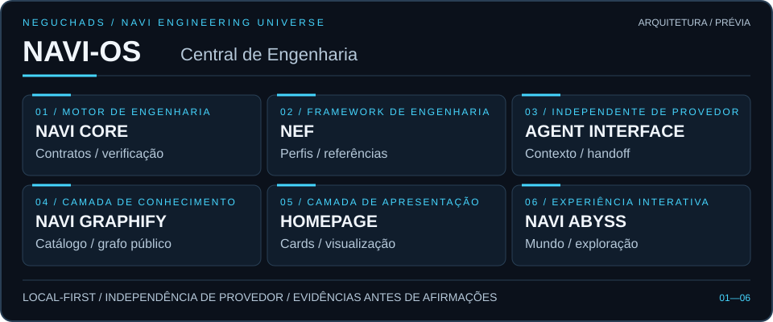
</picture>

| Módulo | Responsabilidade |
| :--- | :--- |
| **[NAVI Core](https://github.com/Neguchads/navi-core)** | Contratos de projetos, CLI e gates reutilizáveis de verificação. |
| **[NEF](https://github.com/Neguchads/navi-core/blob/main/docs/NEF.md)** | Perfis de arquitetura, políticas de referência, roadmap, handoff e aprendizado revisado. |
| **[Universal Agent Interface](https://github.com/Neguchads/navi-core/blob/main/docs/UNIVERSAL_AGENT_INTERFACE.md)** | Contexto portável e handoff estruturado; MCP opcional. |
| **[NAVI Graphify](https://github.com/Neguchads/navi-graphify)** | Catálogo público versionado e ferramentas de grafo de conhecimento. |
| **[NAVI GitHub Homepage](https://github.com/Neguchads/navi-githomepage)** | Identidade visual, cards e renderizador do explorador interativo. |
| **[NAVI Abyss](https://github.com/Neguchads/navi-abyss)** | Oceano cósmico e navegação por estrelas-repositórios. |

**Fluxo de engenharia:** Esclarecer → Planejar → Implementar → Verificar → Registrar evidências → Handoff.

[Arquitetura](docs/ARCHITECTURE.md) · [Roadmap](docs/ROADMAP.md) · [Handoff](docs/HANDOFF.md) · [Política de verificação](docs/NAVI_PILOT.md) · [Execuções do CI Core](https://github.com/Neguchads/navi-core/actions/workflows/ci.yml)

O diagrama descreve funções dos componentes, não saúde em tempo real ou conformidade. O snapshot público abaixo contém métricas datadas; memória privada dos agentes não integra o catálogo público.

## NAVI Engineering Universe

<a href="docs/UNIVERSE.md">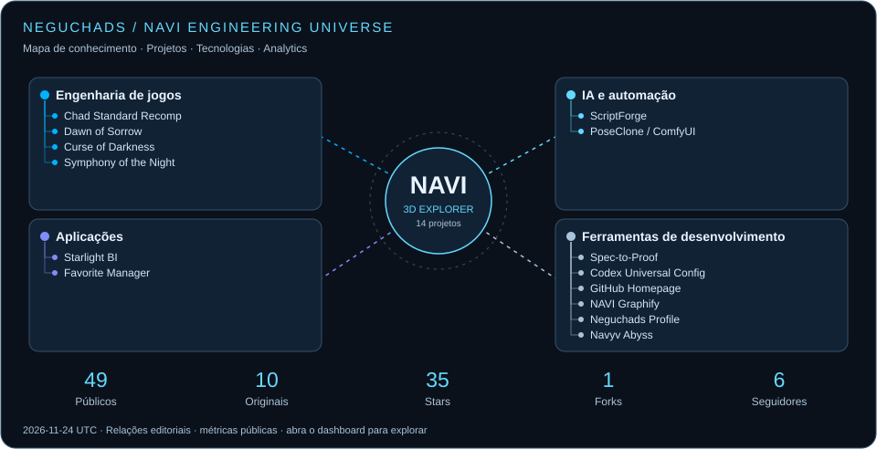</a>

[Dashboard 3D hospedado (quando Pages estiver ativo)](https://neguchads.github.io/Neguchads/) · [Bundle offline após a primeira execução](https://github.com/Neguchads/Neguchads/tree/main/docs/universe) · [Arquitetura e atualização diária](docs/UNIVERSE.md)

## Projetos em destaque

**Ferramentas e frameworks de engenharia** — infraestrutura de desenvolvimento, verificação e conhecimento.

<a href="https://github.com/Neguchads/navi-core">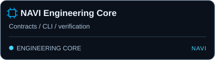</a>
<a href="https://github.com/Neguchads/spec-to-proof">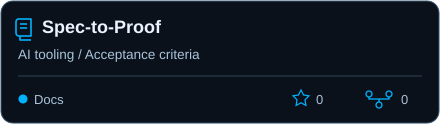</a>
<a href="https://github.com/Neguchads/codex-config-universal">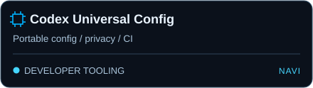</a>
<a href="https://github.com/Neguchads/navi-graphify">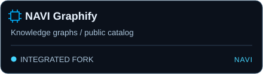</a>
<a href="https://github.com/Neguchads/chad-recomp">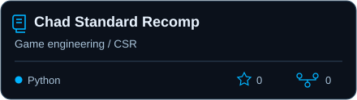</a>

**Projeto de recompilação em destaque**

<a href="https://github.com/Neguchads/ccod-xbox-recomp">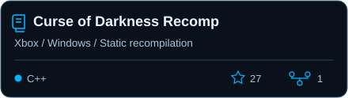</a>

Chad Standard Recomp é um framework, não um jogo. NAVI Graphify é um fork integrado. Os demais jogos continuam no catálogo completo.

<strong>Catálogo completo dos projetos</strong>

### Engenharia de jogos e preservação

| Projeto | Descrição |
| :--- | :--- |
| **[Chad Standard Recomp](https://github.com/Neguchads/chad-recomp)** | Padrão universal de engenharia para ports, recompiladores e jogos. Especificação em desenvolvimento, schema e validador de manifestos. |
| **[Dawn of Sorrow Recompiled](https://github.com/Neguchads/cdos-nintendods-recomp)** | Nintendo DS · Recompilação AOT, Direct3D 12, Vulkan e integração com RecompLauncher. [Releases](https://github.com/Neguchads/cdos-nintendods-recomp/releases) |
| **[Curse of Darkness Recomp](https://github.com/Neguchads/ccod-xbox-recomp)** | Xbox · Port experimental para Windows por recompilação estática. |
| **[Symphony of the Night Recomp](https://github.com/Neguchads/csotn-saturn-recomp)** | Sega Saturn · Motor, runtime nativo, ferramentas de recompilação e testes. |

### Aplicações e inteligência artificial

| Projeto | Descrição |
| :--- | :--- |
| **[Starlight BI](https://github.com/Neguchads/starlight-bi)** | Dashboards interativos e edição visual de dados. |
| **[ScriptForge](https://github.com/Neguchads/ScriptForge)** | Estúdio web de criação de conteúdo e música assistida por IA. |
| **[Favorite Manager](https://github.com/Neguchads/favorite-manager)** | Gerenciador de favoritos para navegadores Chromium com organização por IA local. |
| **[PoseClone / ComfyUI](https://github.com/Neguchads/comfyui)** | Workflows e ferramentas Python para referências visuais e consistência de personagens. |

### Ferramentas para desenvolvedores

**[Spec-to-Proof](https://github.com/Neguchads/spec-to-proof)** — Requisitos, critérios de aceitação e verificação com evidências.  
**[Codex Universal Config](https://github.com/Neguchads/codex-config-universal)** — Configurações portáveis, privacidade e infraestrutura reutilizável de CI.

## Ecossistema de engenharia

<a href="https://github.com/Neguchads/navi-githomepage/tree/main/docs/explore">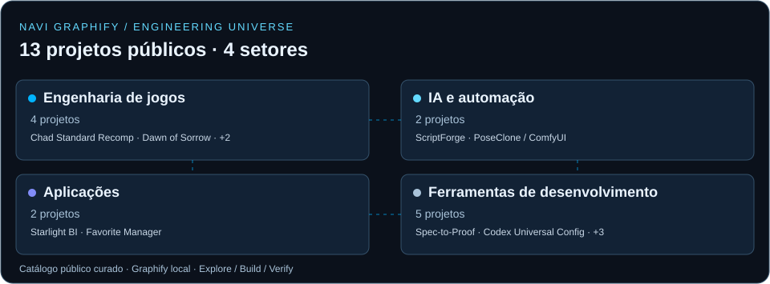</a>

[NAVI Graphify](https://github.com/Neguchads/navi-graphify) fornece o catálogo público versionado. [NAVI GitHub Homepage](https://github.com/Neguchads/navi-githomepage) gera o mapa e o explorador offline. Grafos privados e memória de agentes permanecem locais.

[Abrir explorador e baixar HTML](https://github.com/Neguchads/navi-githomepage/tree/main/docs/explore) · [Arquitetura e privacidade](docs/ECOSYSTEM.md)

## Tecnologias

<picture>
  <source media="(prefers-color-scheme: light)" srcset="assets/stack.pt-BR.light.svg" />
  <source media="(prefers-color-scheme: dark)" srcset="assets/stack.pt-BR.svg" />
  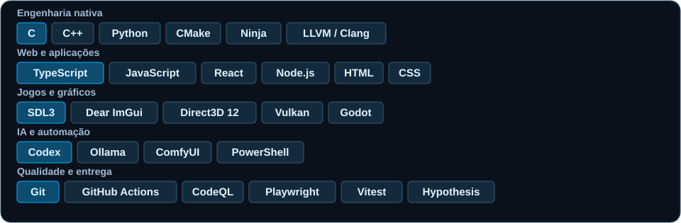
</picture>

Lista de tecnologias em texto

| Área | Stack |
| :--- | :--- |
| Engenharia nativa | C · C++ · Python · CMake · Ninja · LLVM/Clang |
| Aplicações web | TypeScript · JavaScript · React · Node.js |
| Jogos e gráficos | SDL3 · Dear ImGui · Direct3D 12 · Vulkan |
| IA e automação | Codex · Ollama · ComfyUI · PowerShell |
| Qualidade e entrega | Git · GitHub Actions · CodeQL · Playwright · Vitest · Hypothesis |

## GitHub Analytics

O NAVI Universe acima fornece o snapshot público diário. O cartão abaixo é um agregado histórico separado, não atualizado por esse pipeline.

<picture>
  <source media="(prefers-color-scheme: light)" srcset="assets/github-stats.pt-BR.light.svg" />
  <source media="(prefers-color-scheme: dark)" srcset="assets/github-stats.pt-BR.svg" />
  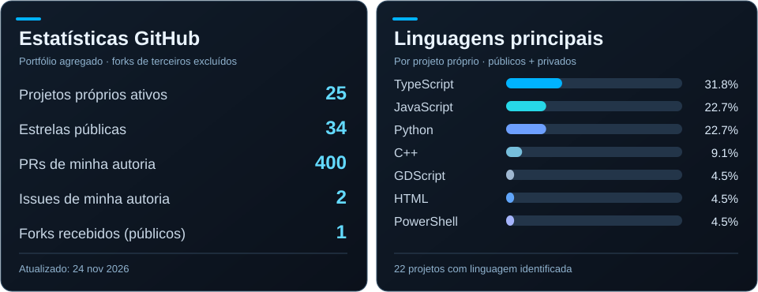
</picture>

Os cartões apresentam um retrato datado; veja a documentação de atualização. Estatísticas agregadas de projetos próprios ativos, públicos e privados acessíveis; forks de terceiros, arquivados e o repositório de perfil são excluídos da contagem e das linguagens. PRs e issues de minha autoria nos repositórios da conta, conforme resultados acessíveis da busca GitHub. Estrelas e forks recebidos: somente projetos públicos próprios. Nenhum nome ou link privado é publicado.

[Metodologia e atualização](docs/PROFILE_ANALYTICS.md)

## Como desenvolvo

- **Reprodutibilidade:** builds incrementais, dependências rastreáveis e documentação técnica.
- **Qualidade:** testes de regressão, propriedades, fuzzing e benchmarks nos projetos aplicáveis.
- **Segurança:** análise estática, verificações de integridade e evidências de distribuição onde disponíveis.
- **Código aberto:** licenças por projeto, atribuição de dependências e respeito aos direitos de terceiros.

Os ports de jogos são experimentais e exigem a própria cópia compatível do jogo. Consulte o README e os termos de cada projeto antes de distribuir ou reutilizar arquivos.

---

  <strong>Explore. Build. Verify.</strong> 
  <a href="https://github.com/Neguchads?tab=repositories">Todos os repositórios públicos</a>

